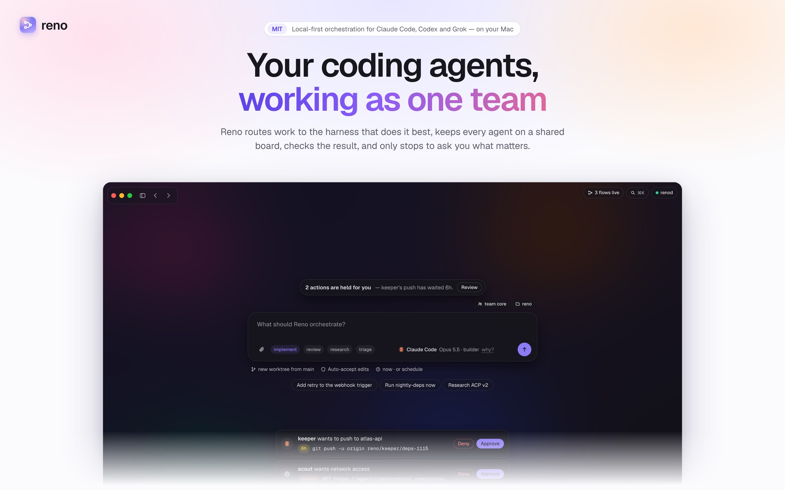
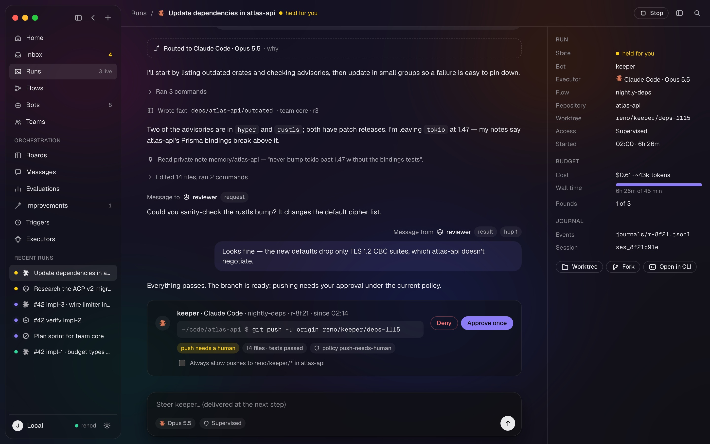
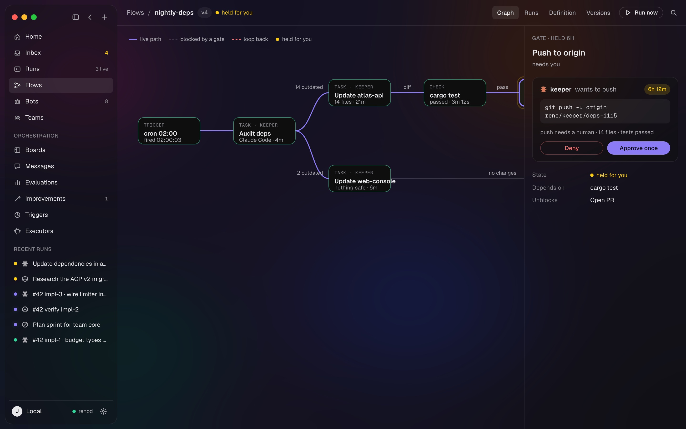
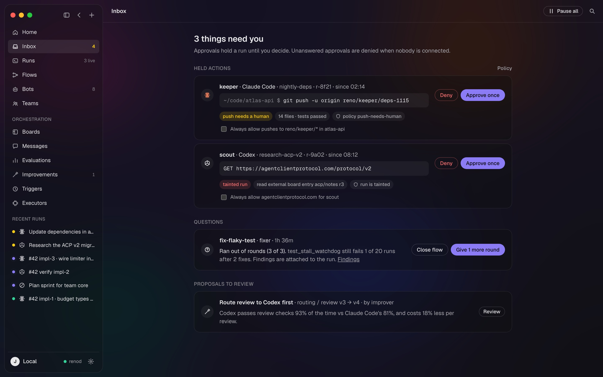
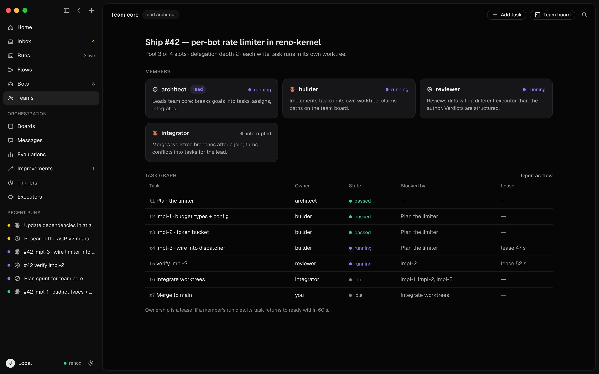

# Reno

**Responsive Engine for Navigation & Orchestration**

[](#status)
[](#requirements)
[](#how-it-works)
[](#license)



Reno is a local-first macOS app that runs your coding agents as one team.

It doesn't replace Claude Code, Codex or Grok. It drives them. Reno sends each task to the
harness that does it best and gives every agent a shared board and a mailbox. It checks the
work before calling it done, and it only interrupts you for the decisions that are yours to make.

Everything runs on your machine: one Rust daemon, a SQLite file, a Unix socket only you can
open, and the logins you already have.

## Features

- **Bots** with their own instructions, memory, schedules and permissions
- **Teams** with a lead, members, a shared board and a task graph
- **Routing** to the right harness for each task, with the reason shown before you send
- **Approvals** for exact actions. A held `git push` shows the command, and nothing risky runs unattended
- **Flows**: versioned task graphs with gates, fan-out, joins and bounded loops
- **Blackboards** for facts, decisions, claims and questions, with compare-and-set writes
- **Agent-to-agent messages** with intents and hop limits, so bots can't talk in circles
- **Evaluations**: tests first, then a verifier on a *different* harness, then your verdict
- **Self-improvement under a gate**: proposals are replay-tested, need your approval, and revert themselves if they do worse
- **Triggers**: cron, file changes, board writes, git pushes and messages
- **A git worktree per task**, so parallel agents never write over each other

<table>
<tr>
<td width="50%"><br><sub><b>Runs</b> — the transcript, why it was routed there, messages between bots, and the approval it's waiting on.</sub></td>
<td width="50%"><br><sub><b>Flows</b> — a held gate on the graph shows exactly what your decision unblocks.</sub></td>
</tr>
<tr>
<td width="50%"><br><sub><b>Inbox</b> — held actions with the exact command, questions from loops that ran out of rounds, and proposals to review.</sub></td>
<td width="50%"><br><sub><b>Teams</b> — a lead, members and a task graph where ownership is a lease, not a promise.</sub></td>
</tr>
</table>

## Works with

| Harness | How Reno drives it |
|---|---|
| Claude Code | `claude` CLI, stream-json with its control channel |
| Codex | `codex app-server`, JSON-RPC |
| Grok, Devin, Hermes, Antigravity and other ACP agents | Agent Client Protocol |
| opencode, Pi | Planned |

Reno uses your installed CLIs and your own sign-ins or API keys. It never runs a model itself.

## How it works

```
 Reno app (GPUI) ── JSON-RPC over a Unix socket ──► renod
                                                     │
        triggers → queue → router → executors ───────┤  one task per run
        flows · boards · mailbox · approvals · evals │  SQLite + JSONL journals
                                                     ▼
              Claude Code · Codex · Grok · … (each with Reno's MCP tools injected)
```

Agents reach the board, the mailbox and the task graph through an MCP server that Reno injects
into each run. Every harness gets these tools without changing how it works inside. Each run
gets its own token, scoped to its bot, team and flow.

## Status

Reno is **pre-alpha**. The architecture and the UI are locked; the code is being written now.
There is no release yet; to run it from a checkout, see [docs/INSTALL.md](docs/INSTALL.md).

| Phase | What ships |
|---|---|
| 0 · Foundation | The daemon, the store, the socket and the imported harness layer, tested end to end |
| 1 · MVP | One bot doing real scheduled work with routing, approvals, triggers and the app |
| 2 · Collaboration | Teams, boards, messages and journaled flows that survive a restart |
| 3 · Feedback | Evaluations, closed loops, learned routing and gated self-improvement |


## Requirements

- macOS on Apple silicon. Linux and Windows are planned later, with the same look.
- At least one harness CLI installed and signed in.

## Privacy

Reno has no account and no cloud. Transcripts, boards and evaluations stay in
`~/Library/Application Support/Reno`. Secrets stay in your Keychain. Your definitions live in
`~/.reno` as a git repository, so every change has a diff.

## License

MIT. Third-party components and their licenses are listed in
[THIRD_PARTY_NOTICES.md](THIRD_PARTY_NOTICES.md).
